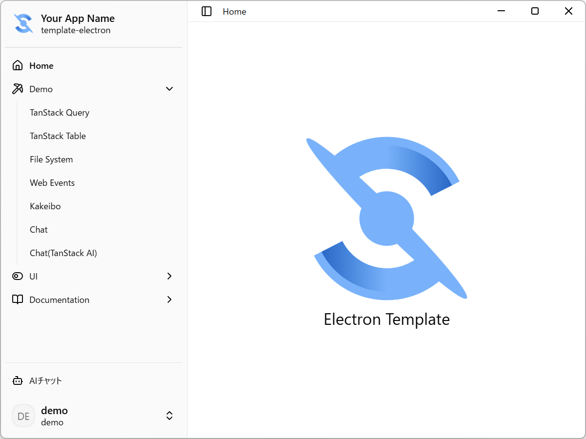
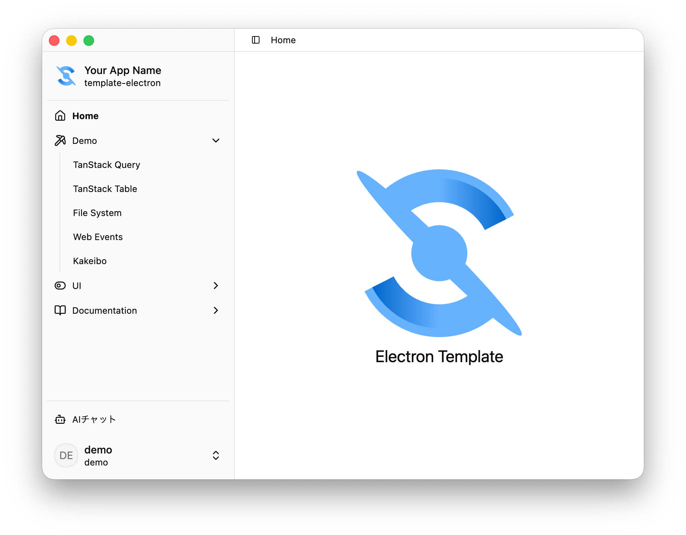

# Electron Template

Electron desktop app、Vite/React renderer、共有 TypeScript package をまとめた pnpm workspace のテンプレートです。

| Screenshot (Windows)               | Screenshot (macOS)                         |
| ---------------------------------- | ------------------------------------------ |
|  |  |

## 動作環境

- Node.js（`node:sqlite` を使えるバージョン）
- pnpm 11

## 新しいアプリを作る

次の仮の名前を、アプリの名前に置き換えます。

- `your-app-name`・`@your-app-name/*`: package 名
- `Your App Name`: 画面に表示するアプリ名
- `apps/desktop/electron-builder.json5` の `appId`・`productName`
- `~/.your-app-name/`: アプリのデータの保存先

サンプルの機能（Todo・保存機能デモ）が不要なら、各層の登録とあわせて取り除きます。

## 使い方

```bash
pnpm install
```

```bash
pnpm dev
```

```bash
pnpm build
```

- `pnpm dev`: web の dev server と Electron app を並列で起動します。
- `pnpm build`: web をビルドしてから desktop をパッケージングします。成果物は `apps/desktop/release/<version>/` に出力されます。
- `pnpm test`・`pnpm typecheck`・`pnpm lint`・`pnpm format`: テスト・型チェック・lint・整形を実行します。

## ライセンス

MIT License
